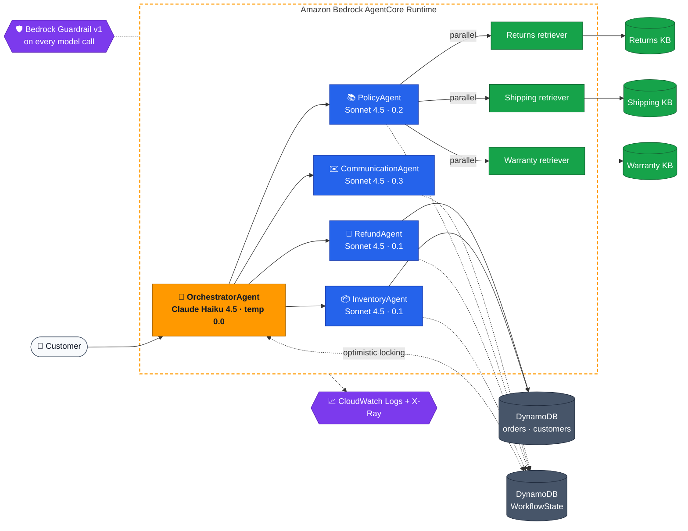
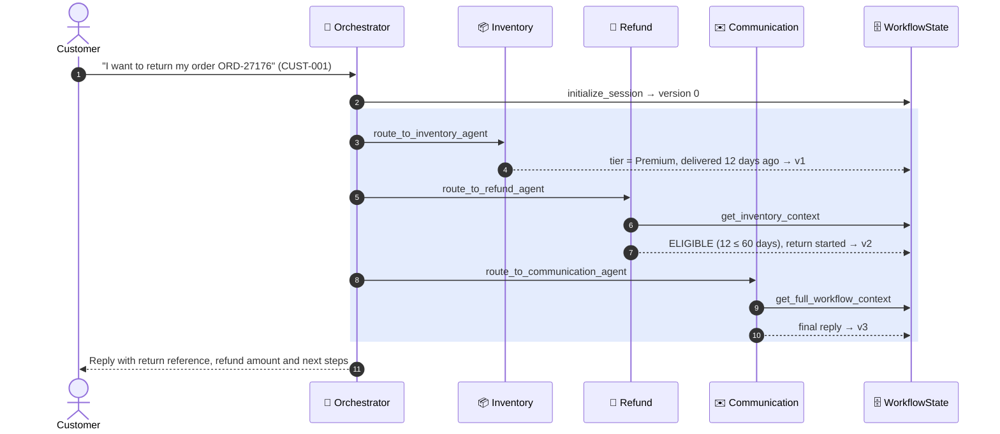
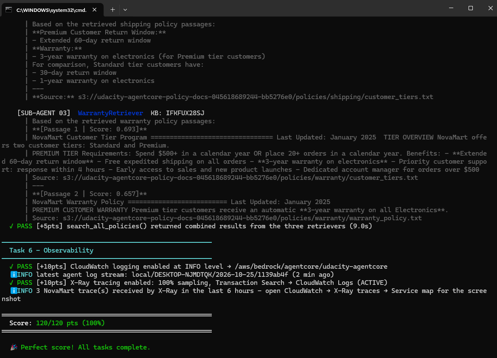
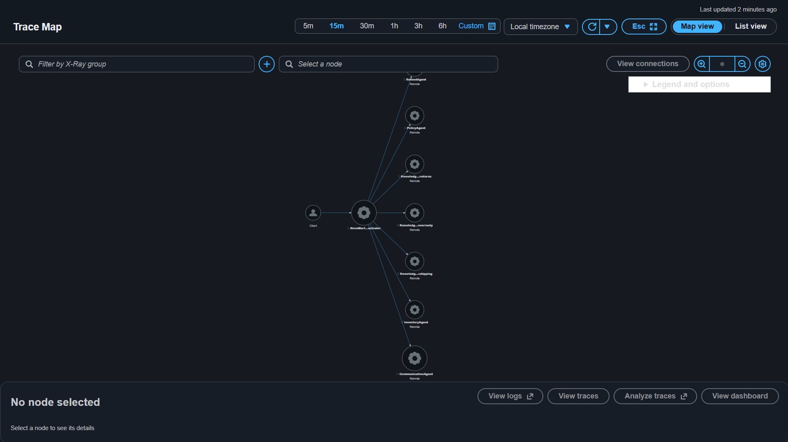

<div align="center">

# 🛒 NovaMart Multi-Agent Customer Support

**Five AI agents that read a customer's message, look up their orders, check company policy,
decide on refunds and write the reply. No human in the loop, every step traced.**


*Udacity AWS Agent Engineer · Course 3 Capstone · Multi-Agent E-commerce RAG*

</div>

---

## 📌 At a glance

| | |
|---|---|
| **The problem** | NovaMart's support team looks up orders, cross-checks policies and drafts replies by hand: slow, inconsistent and error-prone. |
| **The solution** | An **Orchestrator → Workers** system on **Amazon Bedrock AgentCore Runtime**: one routing agent, four specialist agents, three policy retrievers running in parallel. |
| **Safety** | A versioned **Bedrock Guardrail** on every model call (harmful content, PII, competitor talk, price haggling, legal threats, profanity). |
| **Memory and state** | **AgentCore Memory** (session summaries, 7-day retention) plus a shared **DynamoDB WorkflowState** record with optimistic locking. |
| **Observability** | **CloudWatch Logs** at INFO and **AWS X-Ray** at 100% sampling. Every request is one trace from Orchestrator to Knowledge Base. |
| **Result** | ✅ **120 / 120** on the automated test suite · ✅ all three end-to-end scenarios routed correctly |

**Colour key** used throughout this README:

| 🟧 Orchestrator / AWS | 🟦 Worker agents | 🟩 Knowledge and RAG | ⬛ Data stores | 🟪 Safety and observability |
|:---:|:---:|:---:|:---:|:---:|
| `#FF9900` | `#2563EB` | `#16A34A` | `#475569` | `#7C3AED` |

---

## 🧭 Architecture



### The agents

| | Agent | Model · temp | Job | Tools |
|:-:|---|---|---|---|
| 🟧 | **OrchestratorAgent** | Haiku 4.5 · `0.0` | Reads the intent, routes to specialists, manages WorkflowState. **Never writes the reply itself.** | `initialize_session` · `route_to_inventory_agent` · `route_to_policy_agent` · `route_to_refund_agent` · `route_to_communication_agent` |
| 🟦 | **InventoryAgent** | Sonnet 4.5 · `0.1` | Looks up order and customer facts. Reports facts only, never decides. | `check_order_status` · `get_customer_tier` · `list_customer_orders` |
| 🟦 | **RefundAgent** | Sonnet 4.5 · `0.1` | Decides return eligibility: **30 days Standard, 60 days Premium**. Starts the return if eligible and requested. | `get_inventory_context` · `initiate_refund` |
| 🟦 | **PolicyAgent** | Sonnet 4.5 · `0.2` | Fans out to three retriever sub-agents in parallel and synthesises one grounded answer. | `search_all_policies` |
| 🟩 | ↳ Returns / Shipping / Warranty **PolicyRetrieverAgent** | Sonnet 4.5 · `0.0` | Each one queries its own Bedrock Knowledge Base. | `retrieve_*_policy` |
| 🟦 | **CommunicationAgent** | Sonnet 4.5 · `0.3` | Reads the full WorkflowState and writes the warm, final customer reply. | `get_full_workflow_context` |

Models always come from `config.ORCHESTRATOR_MODEL_ID` and `config.WORKER_MODEL_ID`. None are hard-coded.

### Routing rules (enforced by the Orchestrator's system prompt)

| # | When | Then |
|:-:|---|---|
| 1 | **Every** request | `initialize_session` first |
| 2 | Order status, return or refund | Inventory **→** Refund |
| 3 | What a policy means (windows, shipping, warranty) | Policy |
| 4 | Questions about the customer's own account ("am I Premium?") | Inventory, **never** Policy |
| 5 | Maths / price calculations | Straight to Communication, skipping Inventory, Policy and Refund |
| 6 | **Every** request, last step | `route_to_communication_agent`. The Communication agent always writes the reply. |

---

## 🔄 How a request flows



Every write to WorkflowState is a **conditional update on `version`**, so two agents can never overwrite each other's findings.

### Verified end-to-end scenarios

| Scenario | Expected route | Result |
|---|---|---|
| *"I want to return my order ORD-27176"* (CUST-001, Premium) | Orchestrator → Inventory → Refund → Communication | ✅ Return reference and **$149.99** refund. A repeat request is recognised as already started. |
| *"What is the return policy for premium customers?"* | Orchestrator → Policy (3 parallel KBs) → Communication | ✅ 60-day window, compared with 30 for Standard, grounded in all three KBs |
| *"How much are 5 items at $29.99 with 10% off?"* | Orchestrator → Communication only | ✅ $149.95 − $14.995 = $134.955 → **$134.96** |

---

## 🛡️ Guardrail

One published, numbered guardrail version (never `DRAFT`) is attached to **every agent's model**, locally and in the deployed runtime.

| Policy | Setting |
|---|---|
| **Content filters** | Sexual · Violence · Hate → **HIGH** &nbsp;·&nbsp; Insults · Misconduct → **MEDIUM** |
| **PII** | Card numbers · US SSNs → **BLOCK** &nbsp;·&nbsp; Email · Phone → **ANONYMIZE** |
| **Denied topics** (Standard tier, cross-region profile `us.guardrail.v1:0`) | Competitor products · Pricing negotiations · Legal threats |
| **Words** | AWS managed profanity list |

"Pricing negotiations" is defined narrowly, as haggling or asking to change an advertised price. Calculating a total from a stated price and discount is explicitly allowed, so the maths scenario is not blocked.

Run the spot-check from the task spec at any time:

```bash
python scripts/check_guardrail.py   # math allowed · haggling, competitor, legal threat blocked
```

---

## 📊 Results

<table>
<tr>
<td width="50%" valign="top">

**🟩 Automated tests: 120 / 120**

| Task | Area | Score |
|---|---|:-:|
| 2 | Multi-agent graph | 40 / 40 |
| 3 | Guardrail and runtime | 20 / 20 |
| 4 | AgentCore Memory | 15 / 15 |
| 5 | Knowledge Bases | 25 / 25 |
| 6 | Observability | 20 / 20 |

</td>
<td width="50%" valign="top">

**🟪 X-Ray trace map**

One trace per request: *Client → NovaMart-Orchestrator →* the four worker agents, and *PolicyAgent →* the three `KnowledgeBase:*` nodes.

</td>
</tr>
</table>

<details open>
<summary><b>📸 Test suite: 120/120</b></summary>


</details>

<details open>
<summary><b>📸 X-Ray service map</b></summary>


</details>

---

## ☁️ AWS resources

| | Resource | Created by | Purpose |
|:-:|---|---|---|
| ⬛ | DynamoDB `orders`, `customers`, `workflow-state` | CloudFormation stack | Order data and the shared WorkflowState |
| ⬛ | S3 policy-docs bucket (`policies/{returns,shipping,warranty}/`) | CloudFormation + `seed_data.py` | Source documents for RAG |
| 🟩 | S3 Vectors bucket + 3 indexes (1024-dim, cosine) | CloudFormation stack | Vector store behind the KBs |
| 🟩 | 3 Bedrock Knowledge Bases (Titan Text Embeddings V2, self-managed) | AWS Console | `novamart-{returns,shipping,warranty}-policy-kb` |
| 🟧 | AgentCore Runtime (PUBLIC · HTTP, Python 3.12 / arm64) | `deploy`, through the AgentCore CLI and CDK | Hosts the agent graph |
| 🟧 | AgentCore Memory (`summaryMemoryStrategy`, 7 days) | `deploy` | Session summaries |
| 🟪 | Bedrock Guardrail, numbered version | `deploy` | Safety on every model call |
| 🟪 | CloudWatch log group + Transaction Search (100%) | stack + `deploy` | Logs and X-Ray traces |
| ⬛ | IAM execution role | CloudFormation stack | Runtime permissions |

---

## 🚀 Run it yourself

> **Prerequisites:** Python 3.12+, AWS CLI v2 with credentials for **`us-east-1`**, Node.js 20+, [`uv`](https://docs.astral.sh/uv/), and the AgentCore CLI **0.30.0** (`npm install -g @aws/agentcore@0.30.0`). Bedrock access to Claude Haiku 4.5, Claude Sonnet 4.5 and Titan Text Embeddings V2.

<details open>
<summary><b>1 · Foundation</b> (stack, data, environment)</summary>

```bash
python -m venv venv
source venv/bin/activate                 # Windows: venv\Scripts\activate
pip install -r requirements.txt

aws cloudformation deploy --template-file infrastructure/starter_stack.yaml \
  --stack-name udacity-agentcore --capabilities CAPABILITY_NAMED_IAM --region us-east-1

python infrastructure/seed_data.py       # 4 customers, 11 orders, policy documents
cp .env.example .env                     # Windows: copy .env.example .env
python config.py                         # prints every resource name
python tests/test_agent.py task2         # 40/40
```
</details>

<details>
<summary><b>2 · Knowledge Bases</b> (AWS Console, about 10 minutes)</summary>

In **Bedrock → Knowledge Bases → Create → Unstructured Vector Store KB**, create these three. Do **not** use "Managed KB", which creates a different vector bucket.

| Name | S3 data source | Vector index |
|---|---|---|
| `novamart-returns-policy-kb` | `policies/returns/` | `returns-policy-index` |
| `novamart-shipping-policy-kb` | `policies/shipping/` | `shipping-policy-index` |
| `novamart-warranty-policy-kb` | `policies/warranty/` | `warranty-policy-index` |

For each: Titan Text Embeddings V2 → **Use an existing vector store** → S3 Vectors → the stack's vector bucket → the matching index. Then **Sync** the data source and copy the KB ID into `.env` (`RETURNS_KB_ID`, `SHIPPING_KB_ID`, `WARRANTY_KB_ID`).

```bash
python tests/test_agent.py task5         # 25/25
```
</details>

<details>
<summary><b>3 · Deploy and verify</b> (10–20 minutes the first time)</summary>

```bash
python src/agent_orchestrator.py deploy  # guardrail → runtime → memory → observability
# copy the printed AGENTCORE_RUNTIME_ARN, GUARDRAIL_ID and GUARDRAIL_VERSION into .env

python src/agent_orchestrator.py test    # 3 scenarios, each prints its X-Ray trace id
python tests/test_agent.py all           # 120/120
python scripts/check_guardrail.py        # guardrail spot-check
```

Re-running `deploy` is safe: the guardrail and memory are reused and the runtime is updated in place.
</details>

<details>
<summary><b>4 · Talk to it</b></summary>

```bash
python src/agent_orchestrator.py chat                      # interactive, colour-coded trace per agent
python src/demo.py                                         # one full refund request
python src/agent_orchestrator.py invoke "What is the return policy for premium customers?" CUST-002
agentcore status                                           # deployed runtime details
agentcore logs                                             # runtime logs
```

| Test customer | Tier | Order to try |
|---|---|---|
| `CUST-001` Alice Johnson | Premium | `ORD-27176` Wireless Headphones Pro (12 days, eligible) · `ORD-27180` (95 days, too old) |
| `CUST-002` Bob Smith | Standard | `ORD-28001` (45 days, too old) · `ORD-28002` (8 days, eligible) |
| `CUST-003` Carol Davis | Premium | `ORD-29001` Laptop (40 days, eligible only because Premium) |
| `CUST-004` David Lee | Standard | `ORD-30001` Phone Case (20 days, eligible) |
</details>

### `.env` reference

`.env` is git-ignored. Table names, buckets, the IAM role and the log group come from CloudFormation exports automatically.

| Variable | Set in | Source |
|---|---|---|
| `AWS_REGION`, `PROJECT_NAME` | template | `us-east-1`, `udacity-agentcore` |
| `RETURNS_KB_ID`, `SHIPPING_KB_ID`, `WARRANTY_KB_ID` | Step 2 | Bedrock console |
| `AGENTCORE_RUNTIME_ARN` | Step 3 | printed by `deploy` |
| `GUARDRAIL_ID`, `GUARDRAIL_VERSION` | Step 3 | printed by `deploy` (a number, never `DRAFT`) |

---

## 🧠 Design decisions worth knowing

| | Decision | Why |
|:-:|---|---|
| ⬛ | **Optimistic locking on WorkflowState.** Every routing tool reads `version`, runs its worker, then writes with `expected_version`. | Concurrent agents can never silently overwrite each other's findings. |
| 🟧 | **Routing tools run sequentially** (`SequentialToolExecutor`) | Rule 1 must finish before any worker starts and Rule 6 must run last. Concurrent tool calls had raced to create the session record. |
| 🟩 | **Parallel RAG** with `ThreadPoolExecutor(max_workers=3)` + `as_completed()`. A failed retriever is reported as a failure and doesn't sink the other two. | All three Knowledge Bases are queried at once instead of one after another (about 9 s for the whole fan-out in testing). |
| 🟦 | **Refund window re-checked in code** inside `initiate_refund`, with a conditional DynamoDB write | The LLM decides, but an ineligible or already-returned order can never be marked for return. |
| 🟦 | **Workers start each call from a clean context.** WorkflowState is the shared memory. | Stops stale chat history from one customer leaking into another request. |
| 🟪 | **Contact details stripped** from customer lookups | Keeps PII out of model context. The guardrail anonymises anything that slips through. |
| 🟦 | **Explicit rounding rule** in the Communication prompt | Round only the final total. This fixed a live $134.95 vs $134.96 bug. |

---

## 🗂️ Project structure

```text
novamart-agentcore/
├── src/
│   ├── agent_orchestrator.py   ⭐ the 5 agents, routing, guardrail, deploy, memory, observability
│   ├── agent_observability.py     X-Ray subsegment per tool call + CloudWatch logging (provided)
│   ├── agent_utils.py             colour-coded terminal trace UI (provided)
│   ├── agentcore_cli.py           wrapper around `agentcore deploy` (provided)
│   ├── bedrock_kb_retrieval.py    Knowledge Base retrieve() helper (provided)
│   └── demo.py                    one end-to-end request (provided)
├── scripts/check_guardrail.py     guardrail spot-check
├── tests/test_agent.py            automated grader, 120 points (provided)
├── infrastructure/                CloudFormation stack, seed data, cleanup (provided)
├── agentcore/                     AgentCore CLI project + CDK app
├── screenshots/                   120/120 test run · X-Ray service map
├── diagrams/                      original course diagrams
├── docs/UDACITY_STARTER_GUIDE.md  the original task instructions
└── config.py · requirements.txt · .env.example
```

Only `src/agent_orchestrator.py` was required to change. `scripts/check_guardrail.py` was added. Every other provided file is untouched, apart from the files `deploy` writes (`agentcore/*.json`, `agentcore/cdk/package-lock.json`).

---

## 🩺 Troubleshooting

| Symptom | Fix |
|---|---|
| `ExpiredTokenException` anywhere | Your temporary AWS credentials expired. Run `aws configure` (and `aws configure set aws_session_token …`), check with `aws sts get-caller-identity`, then re-run. |
| `config.py` shows `(not yet created)` | Expected until that task is done. Stack values come only from CloudFormation exports, so check that `udacity-agentcore` is `CREATE_COMPLETE`. |
| A KB returns no passages | The data source hasn't been synced, or the ID in `.env` is wrong. Click **Sync** and re-run `task5`. |
| `agentcore: command not found`, or it shows old toolkit help | `npm install -g @aws/agentcore@0.30.0`. Uninstall `bedrock-agentcore-starter-toolkit` if it is present. |
| Deploy fails while packaging | `uv` must be on PATH with internet access. See `agentcore/.cli/logs/`. |
| Deploy fails in CloudFormation | Check the stacks `AgentCore-udacity-default` and `CDKToolkit` in the console, fix the cause, then re-run `deploy`. |
| No traces in the service map | Each run prints `X-Ray trace … published`. Pick a short time range and allow about 60 s. |
| `check_order_status` key error | The Orders table key is `customer_id` + `order_id`, so pass both. |

More detail is in the [original starter guide](docs/UDACITY_STARTER_GUIDE.md#troubleshooting).

---

## 🧹 Clean up and cost

Costs are small and mostly per run: Claude tokens on Bedrock, one-off Titan embeddings during KB syncs, and S3 Vectors storage. AgentCore Runtime is billed by active usage, so an idle deployment costs very little.

```bash
python infrastructure/cleanup.py          # dry run: lists what would be deleted
python infrastructure/cleanup.py --yes    # deletes everything the project created
```

Run cleanup **after** the project has been reviewed. A reviewer may ask for changes.

---

<div align="center">

**Built with** [Strands Agents](https://strandsagents.com/) · [Amazon Bedrock AgentCore](https://docs.aws.amazon.com/bedrock-agentcore/latest/devguide/) · [AgentCore CLI](https://github.com/aws/agentcore-cli) · [Bedrock Knowledge Bases](https://docs.aws.amazon.com/bedrock/latest/userguide/knowledge-base.html) · [Bedrock Guardrails](https://docs.aws.amazon.com/bedrock/latest/userguide/guardrails-create.html)

Commits follow [Conventional Commits](https://www.conventionalcommits.org/) · Course material © Udacity, see [LICENSE](LICENSE.md)

</div>
